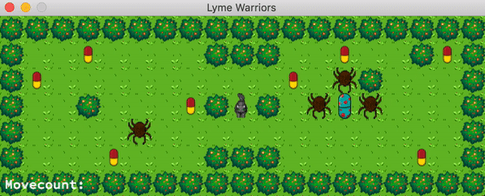
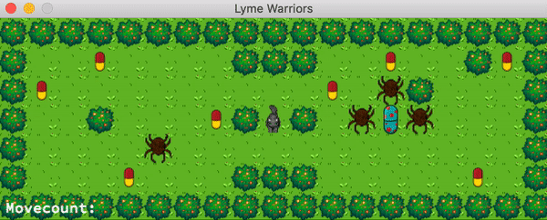

# 🕹️ So_Long 
A 2D game written in C using MLX42, developed as my first graphical project at Codam (42 Network). The game features a Lyme disease-inspired theme in which the player collects antibiotics 💊 while avoiding ticks 🕷️.

The project explores graphics programming, map parsing, player movement, collision detection, and game-state management. Completed with the bonus features!

## Theme - Lyme Disease 

Instead of the original dolphin-themed assignment, I created a game inspired by Lyme disease. Navigate the map, collect all the antibiotics, avoid the ticks, and reach the exit to win!

## 🎮 Game Features

- **Map parsing and validation:** Checks map dimensions, boundaries, characters, and path validity.
- **2D graphics:** Renders the game using textures, sprites, and tiles with MLX42.
- **Player movement:** Supports directional movement, collision detection, and move counting.
- **Collectibles and exits:** Collect all antibiotics to unlock your path to victory.
- **Enemy mechanics:** Avoid ticks to survive.
- **Sprite animation:** Adds animated game elements.
- **Win and lose states:** Displays the outcome of your run.
- **Resource management:** Cleans up allocated memory and graphics resources.

## 🖼️ Gameplay

**🏆 Winning**



**💀 Losing**



## :desktop_computer: Installation 

**Prerequisites:** A compatible environment with the required MLX42 dependencies and build tools.

1.  Compile the game with the following command:
```
$ make
```
2. Execute the game with the following command, and choose your map:
```
> $ ./so_long maps/valid/map2.ber
````
Replace the map path with another valid `.ber` map from the repository.

## ⌨️ Controls

| Key                   | Action          |
| --------------------- | --------------- |
| `W` / `A` / `S` / `D` | Move the player |
| `↑` / `←` / `↓` / `→` | Move the player |
| `ESC`                 | Exit the game   |
